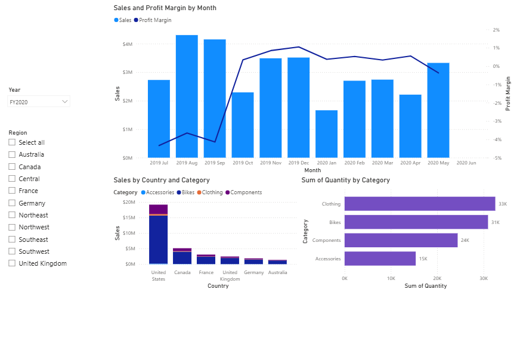
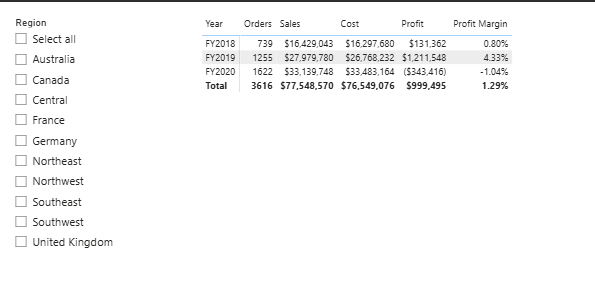
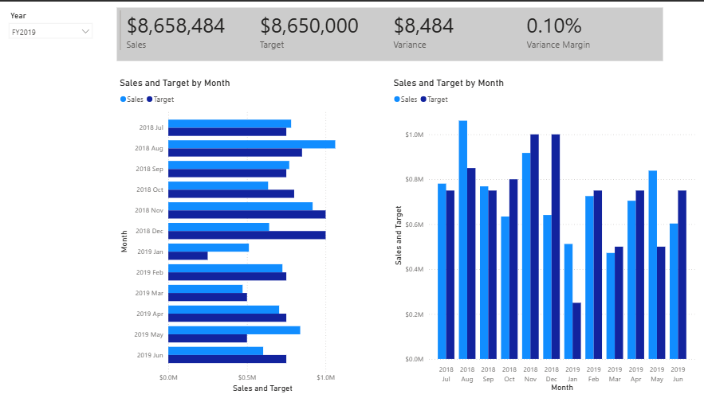

# 📊 Power BI: Adventure Works sales report

A three-page Power BI report on sales, profit and one salesperson's performance against target for Adventure Works, a fictional bike company. I built it in a guided lab from Microsoft's PL-300 course, "Design a report in Power BI Desktop".

## 🔎 At a glance

| | |
|---|---|
| **Tools** | Power BI Desktop and Power BI service |
| **Dataset** | Adventure Works reseller sales sample: 57,851 order lines from July 2017 to May 2020, with product, region, reseller, salesperson and target tables |
| **Bootcamp week** | Week 2, Day 4 (September 2026), Level 3 Data Technician Skills Bootcamp, Leep Talent |
| **Type** | Guided lab. I followed set instructions, so the report design and the choice of visuals were the lab's. |
| **Report file** | [`adventure-works-sales-report.pbix`](adventure-works-sales-report.pbix) is the completed lab file supplied by Leep Talent. The hosted lab environment is deleted when a lab ends, so my own copy wasn't kept. |

## 🎯 Objective

Design a report for Adventure Works' sales team on top of a prepared data model. It needed three pages: an overview of sales and margin, a profit summary by financial year, and a page tracking one salesperson against their target.

## 🗂️ Data

The Sales table has one row per order line, with quantity, unit price, sales and cost. It links to lookup tables for product (category, subcategory and colour), region (10 sales regions in six countries) and reseller. Salesperson and target tables sit alongside.

Financial years run from July to June, so FY2020 is July 2019 to June 2020. The data ends in May 2020, so FY2020 covers 11 months. All amounts are US dollars from sample data, not a real business.

## 🛠️ Approach

The lab starts from a finished data model with its measures already written. The task was to design the report on top of it.

| Page | What it shows | Built with |
|---|---|---|
| Overview | Sales and profit margin by month, sales by country and category, and quantity sold by category | Line and stacked column chart with two axes, stacked column chart, bar chart with data labels, and Year (dropdown) and Region (list) slicers |
| Profit | Orders, sales, cost, profit and profit margin for each financial year | Matrix with a Region slicer |
| My Performance | Sales against target, month by month, for one salesperson (Michael Blythe) | Multi-row card, clustered bar and column charts, a page filter and a Year slicer |

The report uses these measures from the model:

```dax
Profit = SUM('Sales'[Sales]) - SUM('Sales'[Cost])

Profit Margin = DIVIDE([Profit], SUM('Sales'[Sales]))

Orders = DISTINCTCOUNT(Sales[SalesOrderNumber])

Target =
IF(
    HASONEVALUE('Salesperson (Performance)'[Salesperson]),
    SUM(Targets[TargetAmount])
)
```

`DIVIDE` returns a blank rather than an error if sales are zero. `HASONEVALUE` means a target only shows when a single salesperson is selected.

## 📸 The report

**Overview** (filtered to FY2020)



**Profit**



**My Performance** (Michael Blythe, FY2019)



## 📈 Results

These figures come from the sample data, as shown in the report.

- **Three years in total:** sales of $77,548,570 and a profit of $999,495, a margin of 1.29%. FY2019 had the best margin, at 4.33%.
- **FY2020 grew but lost money:** sales rose to $33,139,748 (in 11 months), but cost was higher, giving a loss of $343,416 (−1.04%).
- **The loss came early in the year:** the margin was between −3.7% and −4.3% in each of July, August and September 2019, and August and September were the year's busiest months for sales. The margin was positive from October to April, peaking at 1.05% in December.
- **The US dominates:** it made $19.2 million of FY2020's $33.1 million in sales, and bikes make up most of the sales value in every country.
- **Units and value tell different stories:** clothing sold the most units in FY2020 (32,534), just ahead of bikes (30,965), but bikes bring in far more sales.
- **Michael Blythe beat his FY2019 target by $8,484:** sales of $8,658,484 against $8,650,000, a variance of 0.10%. He beat his monthly target in 5 of the 12 months. His best month for sales was August 2018, at $1.06 million against a target of $0.85 million.

## 💡 Skills used

**Technical**
- Choosing a visual for each question: change over time, comparison across categories, and actual against target
- Showing two measures with different scales on one chart (sales in dollars, margin in percentages)
- Slicers and page-level filters to control what each page shows
- Reading DAX measures, including `DIVIDE` and `HASONEVALUE`
- Laying out a report over several pages in Power BI Desktop

**Transferable**
- Following a detailed technical procedure accurately
- Reading a report as a business user would, and checking what each number includes

## 🧠 Reading the report carefully

- **FY2020 is a part year.** It has 11 months of data, so comparing its total sales with FY2019's 12 months isn't like for like. The margins are a fairer comparison.
- **Margin is a measure, not a column.** It's recalculated for whatever is selected. Adding up monthly margins would give a meaningless total.
- **Know what "Sales" means on each page.** On My Performance, sales reach the salesperson through a table linking salespeople to their regions. The figure is all sales in his three US regions (Northeast, Central and Southeast), not only the orders he took himself.

## 💼 Where this applies

Finance teams and auditors regularly rely on management reports like this one. Checking what a figure includes, such as a full year or a part year, or a person's own orders or their whole region, is what lets you rely on a number or challenge it.

## 📁 Repository contents

| File or folder | What it is |
|---|---|
| `adventure-works-sales-report.pbix` | The completed lab report, supplied by Leep Talent. Open it in Power BI Desktop (free, Windows). |
| `images/` | Screenshots of the three report pages |
