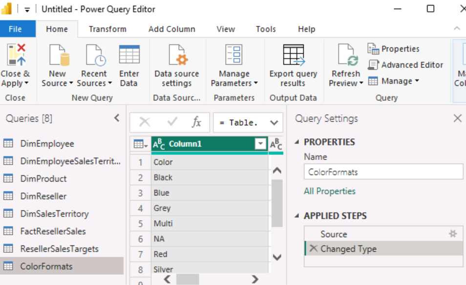
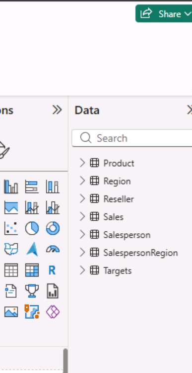
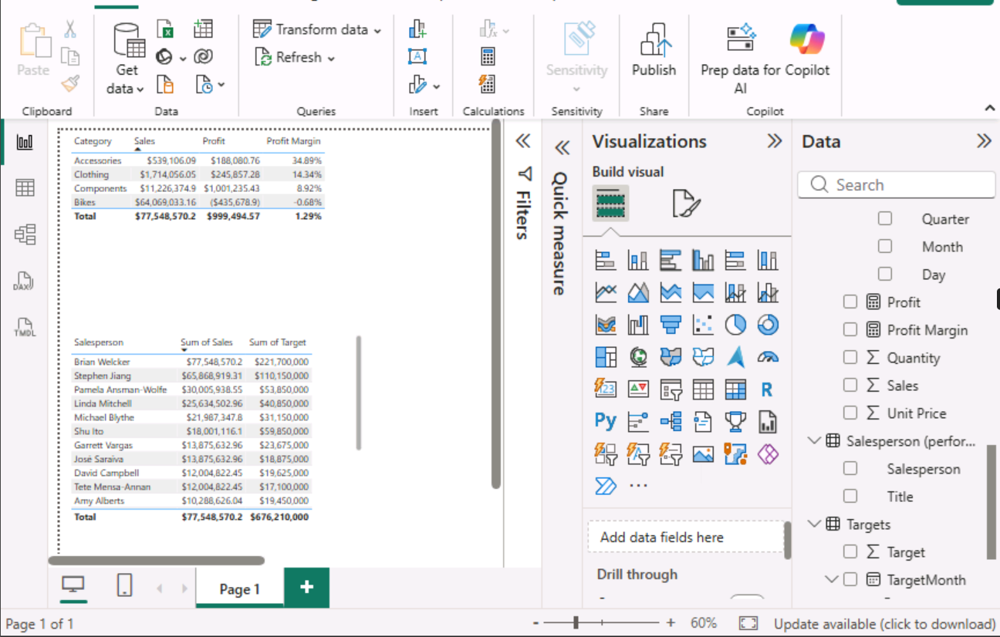

# 📊 Power BI: Adventure Works sales report

A three-page Power BI report on sales, profit and one salesperson's performance against target for Adventure Works, a fictional bike company. Across Microsoft's PL-300 guided labs, I loaded and cleaned the data in Power Query, set up the data model and DAX, and designed the report in "Design a report in Power BI Desktop".

## 🔎 At a glance

| | |
|---|---|
| **Tools** | Power BI Desktop (Power Query and DAX) |
| **Dataset** | Adventure Works reseller sales sample: 57,851 order lines from July 2017 to May 2020, with product, region, reseller, salesperson and target tables |
| **Bootcamp week** | Week 2, Days 3 and 4 (September 2026), Level 3 Data Technician Skills Bootcamp, Leep Talent |
| **Labs completed** | Lab 1: Get data · Lab 2: Clean, transform and load data · Lab 3: Configure a semantic model · Lab 4: Create DAX calculations · Lab 8: Design a report |
| **Type** | Guided labs. I followed set instructions, so the design and the choice of visuals were the lab's. |
| **Report file** | [`adventure-works-sales-report.pbix`](adventure-works-sales-report.pbix) is the completed Lab 8 file supplied by Leep Talent. The hosted lab environment is deleted when a lab ends, so my own copy wasn't kept. |

## 🎯 Objective

Prepare Adventure Works' sales data for reporting, then design a report for the sales team with three pages: an overview of sales and margin, a profit summary by financial year, and a page tracking one salesperson against their target.

## 🗂️ Data

The labs load the data from Microsoft's AdventureWorksDW2020 sample database, plus a sales targets file from Microsoft's PL-300 course files. The Sales table has one row per order line, with quantity, unit price, sales and cost. It links to lookup tables for product, region (10 sales regions in six countries), reseller and salesperson.

Financial years run from July to June, so FY2020 is July 2019 to June 2020. The data ends in May 2020, so FY2020 covers 11 months. All amounts are US dollars from sample data, not a real business.

## 🔄 Preparing the data in Power Query (Labs 1 and 2)

I connected to the source tables, then shaped each one in Power Query before loading it:

- **Kept only what the report needs:** I removed unused columns and filtered rows, keeping salespeople only and finished products only.
- **Expanded related tables:** this brought category and subcategory into Product, and city, state and country into Reseller.
- **Renamed for business users:** I merged first and last names into one Salesperson column and gave columns business-friendly names.
- **Fixed an inconsistent value:** "Ware House" became "Warehouse".
- **Filled a cost gap:** I added a Cost column that uses the product's standard cost where the total product cost is missing.
- **Unpivoted the targets file:** it had one column per month, so I turned it into one row per salesperson per month.



Lab 1: the eight source queries in Power Query Editor, before cleaning.



Lab 2: after cleaning, the model holds seven tables with business-friendly names.

## 🧮 The data model and DAX (Labs 3 and 4)

Sales sits in the middle of the model, linked to the lookup tables. A SalespersonRegion table connects salespeople to the regions they cover, so one salesperson can cover several regions.

DAX calculated columns on the Date table turn calendar dates into Adventure Works' financial year:

```dax
Year = "FY" & YEAR('Date'[Date]) + IF(MONTH('Date'[Date]) > 6, 1)

Month = FORMAT('Date'[Date], "yyyy MMM")

MonthKey = (YEAR('Date'[Date]) * 100) + MONTH('Date'[Date])
```

`MonthKey` gives each month a number, so the text month labels sort in date order rather than alphabetically.

DAX measures used in the report:

```dax
Profit = SUM('Sales'[Sales]) - SUM('Sales'[Cost])

Profit Margin = DIVIDE([Profit], SUM('Sales'[Sales]))

Orders = DISTINCTCOUNT(Sales[SalesOrderNumber])

Target =
IF(
    HASONEVALUE('Salesperson (Performance)'[Salesperson]),
    SUM(Targets[TargetAmount])
)

Variance =
IF(
    HASONEVALUE('Salesperson (Performance)'[Salesperson]),
    SUM(Sales[Sales]) - [Target]
)

Variance Margin = DIVIDE([Variance], [Target])
```

Profit and margin are measures, not stored columns, so they recalculate for whatever is selected. `DIVIDE` returns a blank rather than an error if a total is zero. `HASONEVALUE` means a target only shows when a single salesperson is selected.



Lab 3: a quick check of the model. Bikes made 83% of sales but ran at a small loss, while accessories had the highest margin. In the salesperson table, Brian Welcker's sales equal the company total. He's the Director of Sales and covers all 10 regions, so every sale reaches him through the region table.

## 🛠️ Designing the report (Lab 8)

| Page | What it shows | Built with |
|---|---|---|
| Overview | Sales and profit margin by month, sales by country and category, and quantity sold by category | Line and stacked column chart with two axes, stacked column chart, bar chart with data labels, and Year (dropdown) and Region (list) slicers |
| Profit | Orders, sales, cost, profit and profit margin for each financial year | Matrix with a Region slicer |
| My Performance | Sales against target, month by month, for one salesperson (Michael Blythe) | Multi-row card, clustered bar and column charts, a page filter and a Year slicer |

The slicers make the report interactive: choosing a year or a region updates every chart on the page.

## 📸 The report

**Overview** (filtered to FY2020)


The combined chart puts sales (columns) and margin (line) on separate axes, so a busy month with a poor margin stands out. The country chart stacks the four product categories, and the bar chart compares the quantity sold of each.

**Profit**


The matrix sets out orders, sales, cost, profit and margin for each financial year, with a total row. The Region slicer narrows it to any combination of regions.

**My Performance** (Michael Blythe, FY2019)


The card gives the year's headline numbers. The two charts show sales against target month by month, as bars and as columns.

## 📈 Results

These figures come from the sample data, as shown in the report.

- **Three years in total:** sales of $77,548,570 and a profit of $999,495, a margin of 1.29%. FY2019 had the best margin, at 4.33%.
- **FY2020 grew but lost money:** sales rose to $33,139,748 (in 11 months), but cost was higher, giving a loss of $343,416 (−1.04%).
- **The loss came early in the year:** the margin was between −3.7% and −4.3% in each of July, August and September 2019, and August and September were the year's busiest months for sales. The margin was positive from October to April, peaking at 1.05% in December.
- **The US dominates:** it made $19.2 million of FY2020's $33.1 million in sales, and bikes make up most of the sales value in every country.
- **Units and value tell different stories:** clothing sold the most units in FY2020 (32,534), just ahead of bikes (30,965), but bikes bring in far more sales.
- **Michael Blythe beat his FY2019 target by $8,484:** sales of $8,658,484 against $8,650,000, a variance of 0.10%. He beat his monthly target in 5 of the 12 months. His best month for sales was August 2018, at $1.06 million against a target of $0.85 million.

## 💡 Skills used

**Technical**
- Power Query: removing columns, filtering rows, expanding related tables, merging and renaming columns, replacing values, adding a custom column and unpivoting
- Data modelling: a sales table linked to lookup tables, with a bridging table between salespeople and regions
- DAX calculated columns (`YEAR`, `MONTH`, `IF`, `FORMAT`) and measures (`SUM`, `DIVIDE`, `DISTINCTCOUNT`, `HASONEVALUE`)
- Interactive reports: dropdown and list slicers, and a page-level filter
- Visuals: a combined line and column chart with two axes, stacked column, bar and clustered charts, a matrix and a multi-row card

**Transferable**
- Following a detailed technical procedure accurately
- Reading a report as a business user would, and checking what each number includes

## 🧠 Reading the report carefully

- **FY2020 is a part year.** It has 11 months of data, so comparing its total sales with FY2019's 12 months isn't like for like. The margins are a fairer comparison.
- **Margin is a measure, not a column.** It's recalculated for whatever is selected. Adding up monthly margins would give a meaningless total.
- **Know what "Sales" means on each page.** On My Performance, sales reach the salesperson through the table linking salespeople to their regions. The figure is all sales in his three US regions (Northeast, Central and Southeast), not only the orders he took himself.


## 📁 Repository contents

| File or folder | What it is |
|---|---|
| `adventure-works-sales-report.pbix` | The completed Lab 8 report, supplied by Leep Talent. Open it in Power BI Desktop (free, Windows). |
| `images/` | Screenshots of my lab work and the three report pages |
